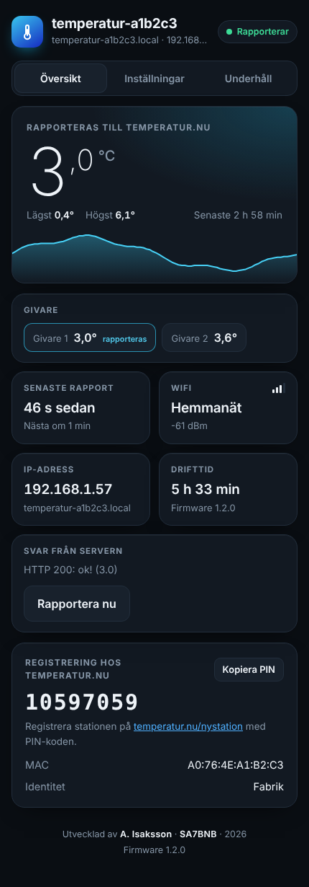
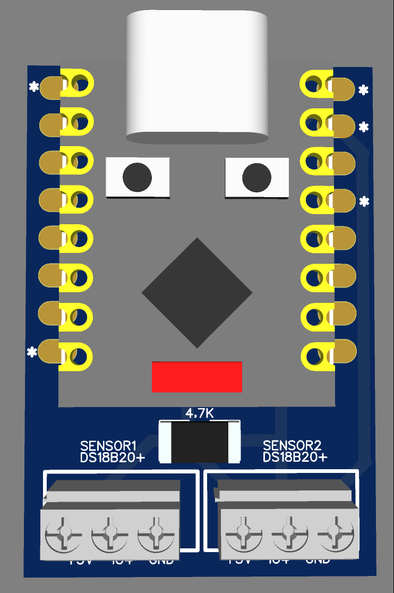
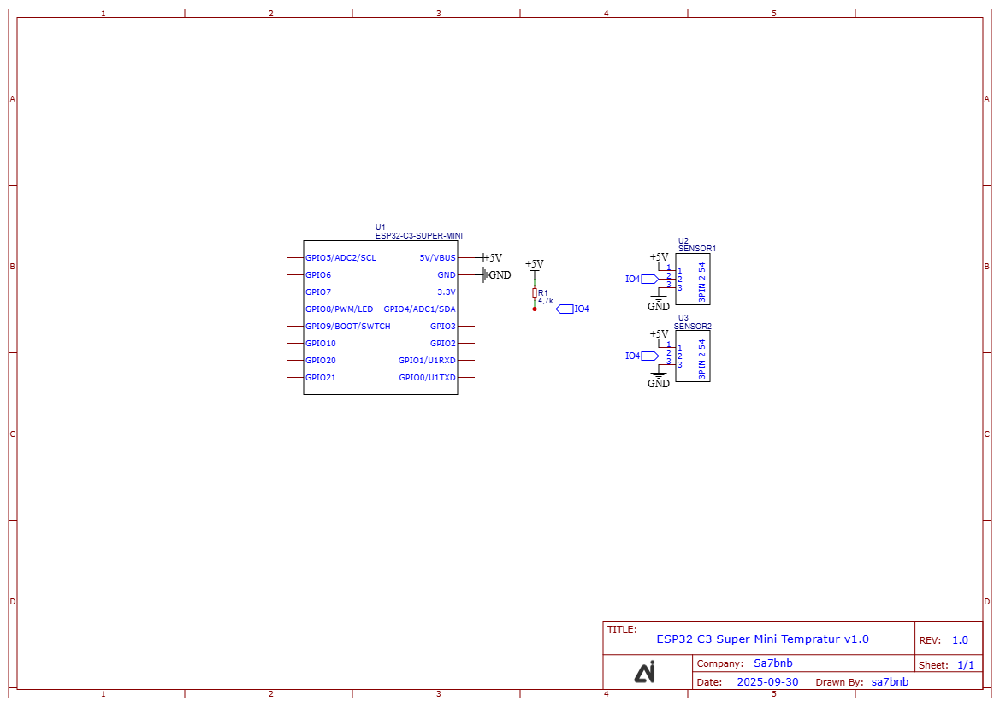
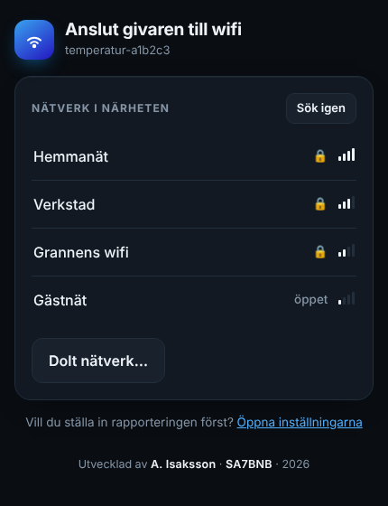
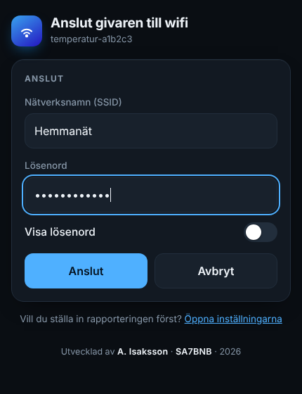
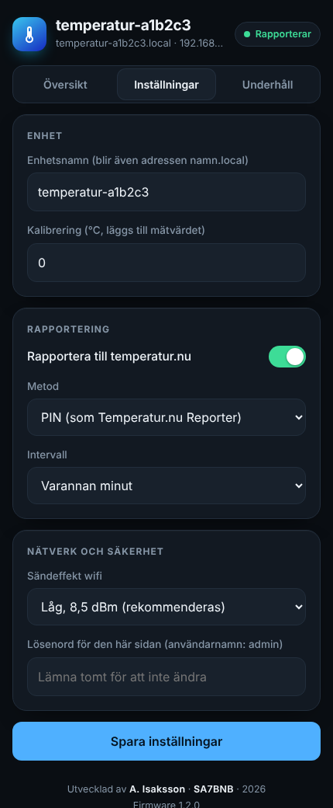
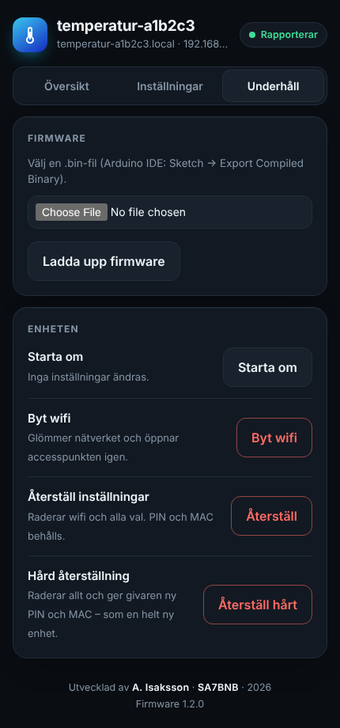

# Temperatur.nu-logger

Wifi-ansluten temperaturgivare som rapporterar utetemperaturen till **[temperatur.nu](https://www.temperatur.nu/)**.
Byggd kring en **ESP32-C3 Super Mini** och en eller två **DS18B20**. Ingen display behövs: allt ställs in från mobilen eller datorn via givarens egna webbsidor.

Utvecklad av **A. Isaksson, SA7BNB** — 2026

  
  &nbsp;&nbsp;
  

> *English: Wi-Fi temperature logger for the Swedish weather site temperatur.nu, built on an ESP32-C3 Super Mini with one or two DS18B20 sensors. No display; setup and configuration are done in the browser. Documentation is in Swedish.*

## Ladda ner

| Fil | Innehåll |
|---|---|
| [`TempNuReporter.ino`](TempNuReporter.ino) | Firmware: wifi, sensorer, rapportering, webbserver |
| [`pages.h`](pages.h) | Webbsidorna som givaren visar |
| [`Manual.pdf`](Manual.pdf) | Användarmanual med bilder |
| [`pcb.zip`](pcb.zip) | Tillverkningsunderlag för kretskortet |
| [`Schematic.png`](Schematic.png) | Kopplingsschema |

Hämta allt på en gång med **Code → Download ZIP** uppe till höger.

## Vad den gör

Givaren mäter temperaturen var femte sekund och skickar mätvärdet till https://www.temperatur.nu/ med jämna mellanrum (varannan minut som standard). Där visas stationen tillsammans med andra mätpunkter i Sverige.

Sitter två givare på kortet rapporteras bara den som visar **lägst** temperatur. Med en givare i varje väderstreck slipper man på så sätt solpåverkan.

## Funktioner

- **Wifi-inställning utan app.** Givaren startar som accesspunkt, söker efter nätverk och låter dig välja och ange lösenord i webbläsaren.
- **Konfigurationssida** med aktuell temperatur, graf över de senaste timmarna, båda givarnas värden, wifi-styrka och svaret från temperatur.nu.
- **Två rapporteringsmetoder:** PIN (samma protokoll som Temperatur.nu Reporter) eller hashkod.
- **Valbart rapportintervall**, 1–30 minuter.
- **Kalibrering** av mätvärdet i steg om 0,1 °C.
- **Firmware-uppdatering** direkt från webbsidan.
- **Valfritt lösenord** för konfigurationssidan.
- **Två nivåer av återställning** via BOOT-knappen, där den hårda ger enheten en helt ny identitet.
- **Återhämtar sig själv** efter strömavbrott och wifi-bortfall.

## Hårdvara

| Antal | Komponent |
|---|---|
| 1 | ESP32-C3 Super Mini |
| 1–2 | DS18B20+ temperaturgivare (gärna vattentät kabelmodell) |
| 1 | Motstånd 4,7 kΩ (pull-up på dataledningen) |
| 2 | Skruvplint, 3 poler |
| 1 | Kretskort, se nedan |

### Kretskort

Kretskortet är ett bärarkort som ESP32-C3 Super Mini löds fast på. Det har pull-up-motståndet monterat och två skruvplintar, `SENSOR1` och `SENSOR2`, som båda går till samma dataledning.

Ladda ner [`pcb.zip`](pcb.zip) och skicka filen till valfri kretskortstillverkare.

  

### Koppling

| DS18B20 | ESP32-C3 Super Mini |
|---|---|
| VCC | 3V3 |
| DATA | GPIO4 |
| GND | GND |

4,7 kΩ sitter mellan DATA och 3V3. Följ märkningen vid plintarna på kortet när du ansluter givarna.

| Funktion | GPIO |
|---|---|
| 1-Wire (DS18B20) | 4 |
| Inbyggd LED | 8 |
| BOOT-knapp | 9 |

## Bygga och ladda upp

1. Installera **Arduino IDE** och ESP32-stödet (Boards Manager: *esp32* från Espressif).
2. Installera biblioteken **OneWire** (Paul Stoffregen) och **DallasTemperature** (Miles Burton) via Library Manager.
3. Skapa en mapp som heter `TempNuReporter` och lägg `TempNuReporter.ino` och `pages.h` i den. Arduino IDE kräver att mappen har samma namn som `.ino`-filen.
4. Öppna `TempNuReporter.ino` och välj inställningar under *Tools*:

   | Inställning | Värde |
   |---|---|
   | Board | ESP32C3 Dev Module |
   | USB CDC On Boot | Enabled |
   | Partition Scheme | Minimal SPIFFS (1.9MB APP with OTA/190KB SPIFFS) |

5. Ladda upp via USB.

Kompilerar mot arduino-esp32 3.3.9.

## Kom igång

1. Strömsätt givaren. Den öppnar wifi-nätverket **Temperatur-XXXXXX**.
2. Anslut med mobilen. Inställningssidan öppnas automatiskt, annars: `http://192.168.4.1/`
3. Välj ditt wifi, ange lösenordet och tryck **Anslut**.
4. Öppna konfigurationssidan på `http://temperatur-xxxxxx.local/` eller IP-adressen som visas.
5. Registrera stationen på [temperatur.nu/nystation](https://www.temperatur.nu/nystation) med **PIN-koden** från sidan.

  
  
  

Hela genomgången med bilder finns i **[användarmanualen (PDF)](Manual.pdf)**.

## Rapportering till temperatur.nu

| Metod | Adress |
|---|---|
| PIN (standard) | `http://report.temperatur.nu/rapportera_v2.php?pin=…&mac=…&t=…&n=…&u=…` |
| Hashkod | `https://www.temperatur.nu/rapportera.php?hash=…&t=…` |

- Temperaturen skickas med en decimal.
- Misslyckas en rapport görs ett nytt försök efter 60 sekunder.
- PIN-koden beräknas från enhetens MAC-adress.

## Återställning

| BOOT-knappen | LED | Resultat |
|---|---|---|
| Håll 5 s och släpp | snabb blink, fast sken, sedan 3 blink | Alla inställningar raderas. PIN och MAC behålls. |
| Håll 15 s | 6 blink | Hård återställning: allt raderas och enheten får ny slumpad PIN och MAC. |

Efter en hård återställning uppträder givaren som en helt ny enhet, både mot temperatur.nu och mot routern. Båda återställningarna finns även som knappar under fliken *Underhåll*.

  

## LED

| LED | Betydelse |
|---|---|
| Blinkar två gånger per sekund | Accesspunkt, väntar på wifi-inställning |
| Blinkar långsamt vid start | Ansluter till sparat wifi |
| Kort blink | En rapport skickas |
| Släckt | Normal drift |

## Tack

Rapporteringsprotokollet med PIN följer [Temperatur.nu Reporter v2.5](https://www.temperatur.nu/), vars ESP32-C3-version var utgångspunkten för det här projektet.

---

Utvecklad av A. Isaksson, SA7BNB — 2026
